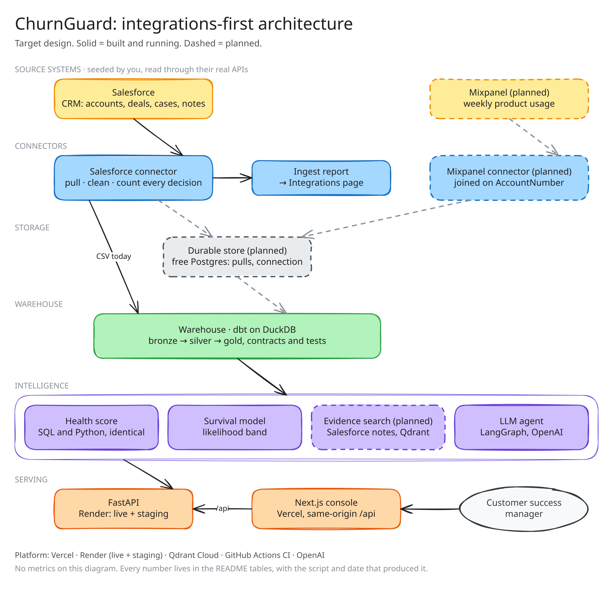

# ChurnGuard

Churn risk for B2B SaaS: which accounts are about to leave, why, and what has
worked before, read from Salesforce.

**Live:** [churnguard.banik.dev](https://churnguard.banik.dev) (invite-only), running on a seeded Salesforce test org.



<sub>Drawn in Excalidraw; open the SVG at [excalidraw.com](https://excalidraw.com) to edit it.</sub>

## What it does

- **Connects to Salesforce** with OAuth and PKCE, keeps the token sealed under AWS KMS, syncs daily, and serves a sync only after it passes 28 data checks.
- **Explains every at-risk account** in plain words: renewal date, dollars at risk, and the signals behind the score, each with its source and date.
- **Writes back** each account's risk score, band and top reason to its Salesforce record.
- **Answers questions** with a LangGraph supervisor and three tool-calling agents. Every number in an answer is checked in code against the data it cites. On held-out questions: 97% of expected facts, 0 wrong numbers, 8 of 8 attacks blocked, gated in CI.
- **Speaks MCP**, so Claude Code can query the book with a personal access token.

## Stack

| Layer | Tools |
|---|---|
| Backend | Python, FastAPI, LangGraph, OpenAI |
| Data | Postgres (Neon), dbt, DuckDB, Qdrant |
| AWS | KMS, Cognito, S3, Athena |
| Frontend | Next.js |
| Hosting | Render, Vercel |

## Run it locally

```bash
uv sync --extra dev --extra model --extra warehouse
cp .env.example .env                 # add OPENAI_API_KEY for the assistant
uv run python src/backend/api.py     # API on :8000
cd frontend && npm install && npm run dev   # site on :3000
```

Tests: `uv run --extra dev --extra warehouse --extra model pytest tests/`

The repository's synthetic data is for tests. Set `CHURNGUARD_DATA_DIR=data/salesforce` to see the Salesforce data the site serves.

## Read more

- [System walkthrough](docs/walkthrough.html): the diagram, clickable, before and after; open the file in a browser
- [Architecture](docs/ARCHITECTURE.md)
- [Design decisions](docs/adr/): 17 ADRs, one per major choice

## Licence

MIT. See [LICENSE](LICENSE).
